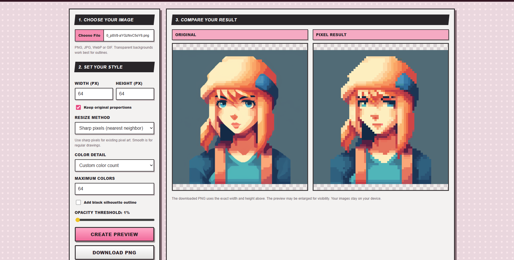
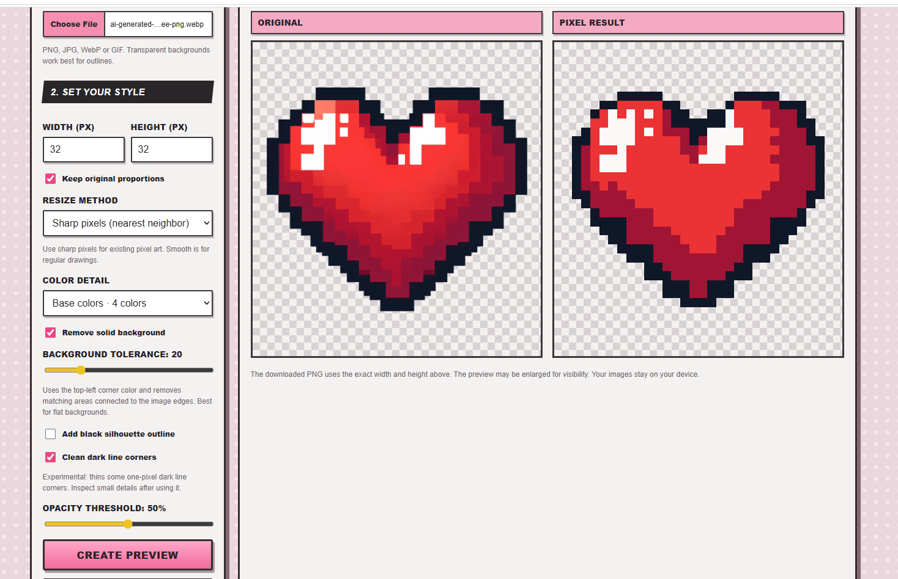

# Pixel Art Cleanup Tool

An offline, rule-based pixel-art cleanup project with a browser app and an Aseprite extension. Resize artwork to a target resolution, simplify its colors, and experiment with outlines and simple background removal. Images are processed locally on your device; no AI model or online service is used.

> This is an early tool for creating a starting point. It does not guarantee pixel-perfect lines, reconstruct an original pixel grid, or understand the contents of an image. Results often benefit from manual cleanup.

## Examples

The browser app shows the original and processed image side by side before download.

### Portrait at 64 × 64



### Heart at 32 × 32



These screenshots show earlier interface versions; the current app includes additional options.

## Browser app

Open `PixelCleanerStudio.html` in a modern browser. No installation or server is required.

1. Choose a PNG, JPEG, WebP, or GIF (only one GIF frame is used).
2. Enter the desired width and height. Enable **Keep original proportions** to link the values.
3. Choose a resize method and color detail. Optionally enable background removal or outline controls.
4. Select **Create preview**, inspect the result, and click **Download PNG**.

The preview is enlarged for visibility; the downloaded PNG uses the chosen pixel dimensions. Outputs are limited to 1–1024 pixels per side and 262,144 pixels in total.

### Resize and color options

| Option | What it does |
| --- | --- |
| Sharp pixels | Uses nearest-neighbor sampling, useful for existing pixel art. |
| Preserve dark outlines | Samples source regions to retain dark pixels near transparent silhouette edges. Tune **Outline sensitivity**; lower values may retain thin lines but add stray pixels. |
| Smooth drawing | Applies image smoothing before reducing resolution. |
| Color detail | Reduces colors to preset limits (4, 8, or 16), or a custom limit of 2–64. Fewer colors may merge highlights and shadows. |

Preserved outlines use colors sampled from the original image, so their colors can exceed the selected palette limit. This method does not recover the image's original grid or guarantee one-pixel outlines.

### Background and outlines

- **Remove solid background** samples the top-left pixel and removes similarly colored areas connected to the image edges. Adjust tolerance carefully; it works best with flat backgrounds. If the top-left pixel is already transparent, this step is skipped.
- **Add black silhouette outline** draws into adjacent transparent pixels inside the selected canvas size. Leave transparent padding to prevent clipping.
- **Clean dark line corners** is an experimental thinning heuristic that can remove small details; compare with it disabled.
- **Opacity threshold** controls which resized pixels become opaque. Higher values remove more translucent fringe but can erase fine features.

A checkerboard drawn into an image is part of the image, not transparency. Solid-background removal will not reliably remove a two-color checkerboard or complex background.

## Aseprite extension

The separate Lua-based extension supports manual block size, preset or custom palette size, a black silhouette outline, and an opacity threshold. It works on the visible layers of the active frame and creates a new sprite; save it separately. Its controls and algorithm differ from the browser app.

1. In Aseprite, go to **Edit → Preferences → Extensions → Add Extension**.
2. Select `PixelCleaner.aseprite-extension` and confirm installation.
3. Open artwork and choose **File → Scripts → Pixel Cleaner**.

Aseprite v1.2.18 or later supports script extensions. The extension has not been verified in Aseprite as part of this release.

## Project files

```text
PixelCleanerStudio.html          Standalone browser application
pixel_cleaner.lua                Aseprite extension source
package.json                     Aseprite extension manifest
PixelCleaner.aseprite-extension  Installable extension archive
```

To rebuild the extension archive after editing, ZIP `package.json` and `pixel_cleaner.lua` at the archive root and rename the archive to `.aseprite-extension`.

## How it works

The browser uses canvas resizing, weighted color clustering and optional local heuristics for silhouette edge retention and line cleanup. The Aseprite extension averages blocks and performs weighted color clustering. Both are deterministic image-processing approaches; neither can invent missing artistic details. Smaller output dimensions necessarily discard information, and complex or baked-in backgrounds may require manual editing.

## Status and limitations

- The browser app processes a single image and does not preserve animation.
- Automatic pixel-grid detection, complex subject segmentation, and guaranteed clean outlines are not implemented.
- Large images and high palette counts can take time to process.
- The bundled extension has not been tested in a live Aseprite session.

